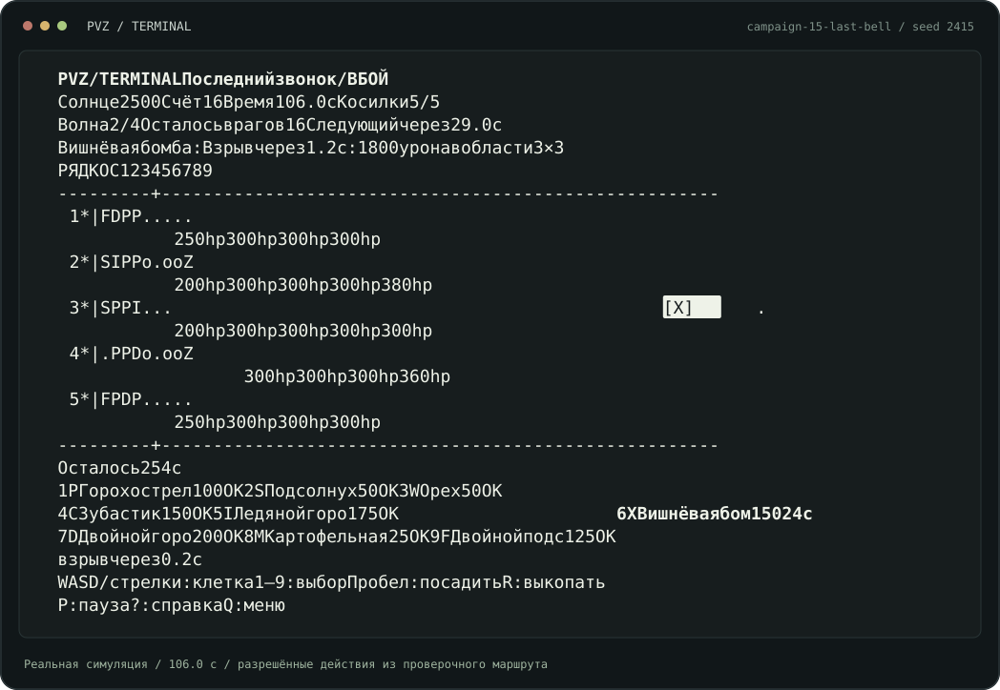

# PvZ Terminal

Стройте защиту из растений, копите солнце и удерживайте пять рядов от зомби. Всё происходит в терминале.



**15 уровней кампании · 46 испытаний · бесконечное выживание**

Девять растений, пять типов зомби и три сложности. Газонокосилки дают последнюю попытку удержать ряд. Испытания меняют экономику и правила посадки: ограничивают запас солнца, число растений или доступные клетки. Победы открывают уровни кампании; рекорды и восемь игровых достижений сохраняются локально.

## Начать играть

Нужны **Python 3.12+**, Linux или macOS и терминал с поддержкой `curses`. Окно должно быть не меньше **76 × 24**. Игровых зависимостей нет: достаточно стандартной библиотеки Python.

Из папки проекта:

```bash
python3 -m pvz
```

В меню выберите кампанию, испытание или выживание. Начните с «Первого ростка»: первые волны дают время разобраться со стрельбой и доходом.

[Установка и решение проблем](docs/installation.md) · [Правила игры](docs/gameplay.md) · [Все сценарии](docs/scenarios/README.md)

## Управление

| Клавиша | Действие |
| --- | --- |
| Стрелки / WASD | Выбрать клетку |
| 1–9 | Выбрать растение |
| Пробел | Посадить |
| R | Выкопать без возврата солнца |
| P | Пауза / продолжить |
| ? / H | Справка |
| Q / Esc | Вернуться в меню |
| Enter | Открыть пункт меню |
| PgUp / PgDown | Перелистать каталог и длинную справку |

Справка, пауза и слишком маленькое окно останавливают игровое время. В HUD видны цены, перезарядки и ограничения сценария. `#` отмечает клетку, в которой нельзя сажать.

## Повторы и отдельные запуски

```bash
# Список всех 61 сценария без запуска интерфейса
python3 -m pvz --list-scenarios

# Сразу начать первый уровень
python3 -m pvz --scenario campaign-01-first-sprout

# Выживание с записью повтора, без сохранения рекордов
python3 -m pvz --survival --seed 71 --no-save --record-dir ./replays

# Справка по параметрам запуска
python3 -m pvz --help
```

Каждая записанная партия получает отдельный JSON-файл. Его можно проверить и проиграть без терминального интерфейса через `tools/replay.py`. Паузы не добавляют игрового времени, готовые файлы не перезаписываются. [Как записывать и сравнивать повторы](docs/replays.md).

## Разработка

```bash
python3 -m unittest discover -s tests -v
```

Игровая логика находится в [`pvz/game.py`](pvz/game.py), баланс в [`pvz/constants.py`](pvz/constants.py), интерфейс в [`pvz/ui.py`](pvz/ui.py). Сценарии хранятся в [`pvz/data/`](pvz/data/); для каждого есть проверочный маршрут разрешённых посадок.

Превью выше получено из настоящего `Game` через `draw_game`, на 106-й секунде последнего уровня кампании. Для обновления рисунка запустите `python3 tools/render_preview.py`: генератор проверяет, что повтор тех же действий даёт тот же отпечаток состояния.

Это самостоятельная мини-игра по мотивам Plants vs. Zombies. Проект не связан с авторами оригинальной игры.
